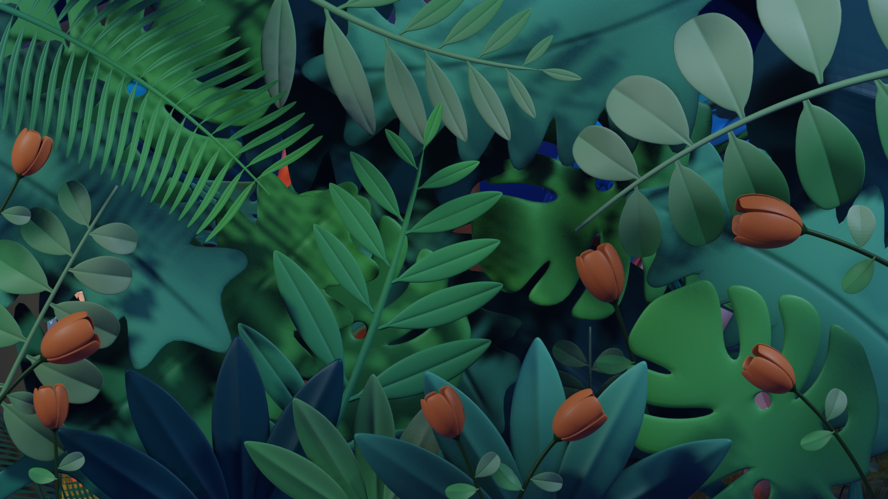
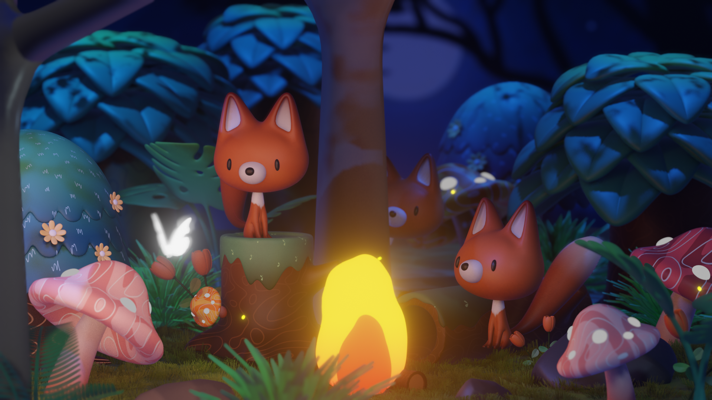
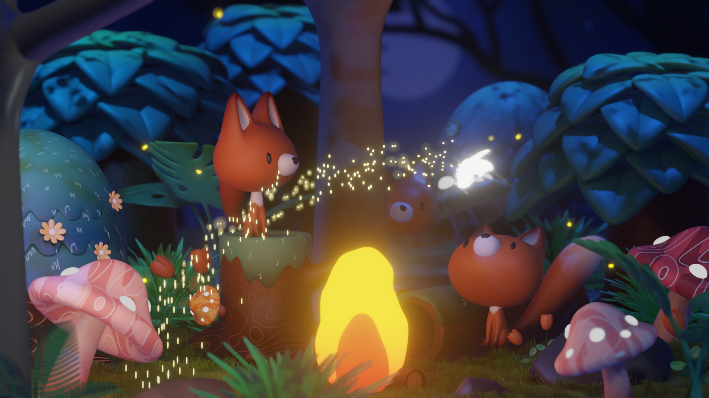
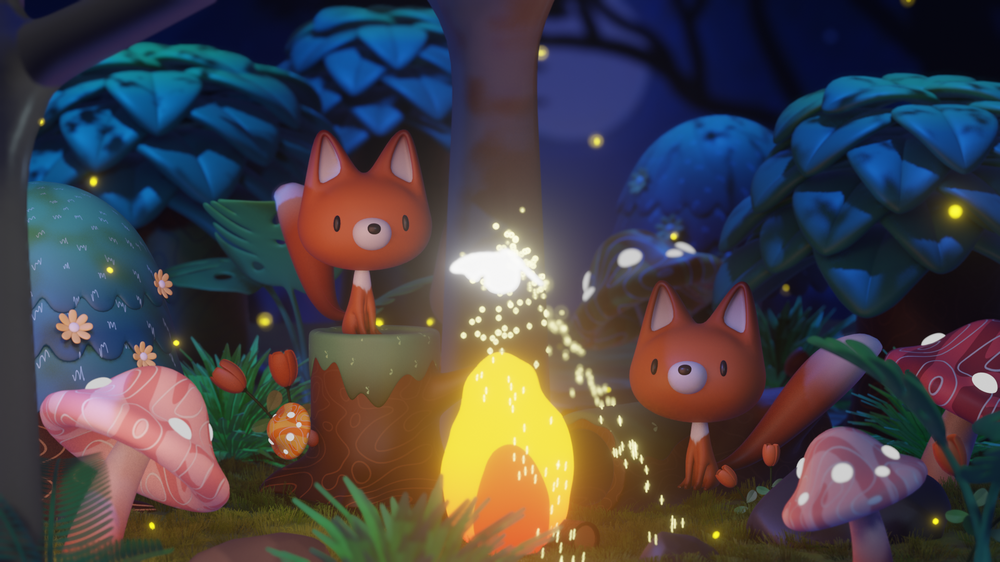

# 狐狸森林动画（Fox-Animation）

> 以 **Blender 4.5 + EEVEE Next** 制作的 3D 角色动画短片：一只可爱的狐狸在充满生机的森林环境中活动，综合展示角色建模、毛发、次表面散射皮肤、骨骼绑定、环境搭建、灯光与后期合成等完整制作流程。

## 项目简介

本项目是跟随网络视频教程制作的学习型 / 作品集展示项目，完整覆盖「角色 → 场景 → 动画 → 渲染 → 合成」的全流程。整体风格偏向**写实与风格化的折中**（semi-stylized / stylized realism）。

- 参考教程：https://www.bilibili.com/video/BV14u41147YH/
- 制作工具：Blender 4.5（渲染引擎 EEVEE Next）
- 项目类型：个人作品集（Portfolio）

## 基本规格

| 项目 | 规格 |
| --- | --- |
| 分辨率 | 1920 × 1080（Full HD，16:9） |
| 帧率 | 24 fps |
| 时长 | 250 帧（约 10.4 秒） |
| 渲染引擎 | EEVEE Next（实时渲染） |
| 输出格式 | H.264 MP4 + PNG 序列 |

## 成品展示

**最终渲染视频**：`Fox-Animation.mp4`（H.264，约 10.4 秒）

**渲染序列**（`Sequence/` 共 250 帧，以下为部分关键帧）：

| 帧 | 画面 |
| --- | --- |
| 第 1 帧 |  |
| 第 80 帧 |  |
| 第 160 帧 |  |
| 第 250 帧 |  |

## 技术亮点

| 模块 | 实现 |
| --- | --- |
| 角色材质 | **Principled BSDF** + 完整 **次表面散射（SSS）** 参数组，塑造通透的狐狸皮肤 |
| 毛发 | **粒子毛发系统**（基础毛发 + 插值子毛发 + 成簇 Clump + 卷曲 Kink） |
| 骨骼绑定 | Armature 骨架 + deform 变形骨骼 + 尾巴拉伸骨骼（`boneStretcher`） |
| 动画 | Action + FCurve 关键帧 + Empty 空物体控制器（驱动相机 / 蝴蝶 / 火焰） |
| 环境 | ambientCG 4K PBR 贴图（`Wood059`、`Bark001`）+ HDRI 环境光（`forest.exr`） |
| 灯光 | HDRI 环境光 + 人工灯光 + 火焰自发光 + **灯光链接（Light Linking）** |
| 后期合成 | Blur（景深）+ Glare（泛光）+ Color Balance + Denoise + Lens Distortion |
| 建模 | **Subdivision Surface**（细分曲面）为主，配合 Displacement / Solidify / Shrinkwrap 等修改器 |

## 场景构成

场景为一个多层次森林环境，通过多个 Collection 组织：

| 集合 | 内容 |
| --- | --- |
| `GRFox` | 狐狸角色（`foxbody` / `foxhead` / `foxeyes` / `foxnose` / `fox_tail` 等） |
| `GRTreeBig` / `GRTreetrunk` / `GRtree` | 大型树木与树干 |
| `GRStones` / `GRMushroom` | 石头、蘑菇 |
| `GRguibeizhu` / `GRzonglvshu` | 龟背竹、棕榈树 |
| `GRenvironment` | 环境植被（草、苔藓、落叶等） |
| `GRfire` / `GRlight` / `GRparticles` | 火焰、灯光、粒子 |

## 目录结构

```
Fox-Animation/
├── Fox-Animation.blend   # Blender 主工程文件（约 64 MB，未压缩）
├── Fox-Animation.mp4     # 最终渲染视频（H.264）
├── Sequence/             # PNG 渲染序列（250 帧，1920×1080）
│   ├── 0001.png
│   ├── 0002.png
│   └── ...（共 250 帧）
└── README.md
```

## 注意事项

`.blend` 文件中记录了纹理的原始相对路径（如 `..\..\..\Pre - Research\KURT TEXTGURE\...`、`3 - Materials\Wood059_4K-JPG\...`）。若在不同目录或机器上打开项目，需重新定位这些纹理，否则会出现贴图丢失（紫红色显示）。

> 本文档基于对 `Fox-Animation.blend`、渲染序列及输出视频的分析整理而成。
